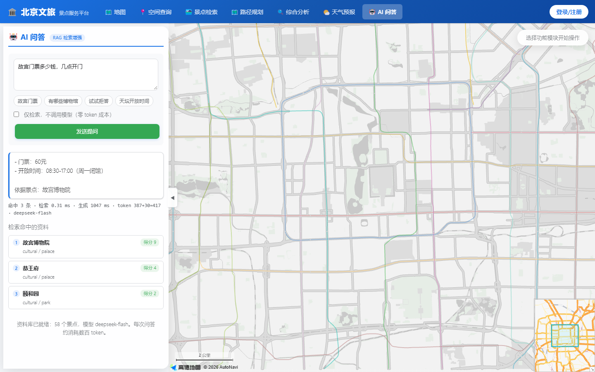

# 北京市旅游信息服务平台

面向文旅场景的 GIS 综合服务平台。前端交互、后端接口、数据库设计全部自研，覆盖景点管理、空间查询、路径规划、综合分析、天气预报与用户认证六大模块。

**技术栈**：FastAPI + SQLAlchemy 2.0（异步）+ MySQL + Shapely + 高德地图 Web API + 原生 JS

**规模**：7 张数据表 · 30 个 REST 端点 · 7 个路由模块 · 约 8,500 行代码

---

## 功能模块

| 模块 | 能力 | 关键实现 |
|---|---|---|
| 用户认证 | 注册、登录、个人信息管理 | JWT + bcrypt 密码哈希，Token 有效期可配置 |
| 景点管理 | 景点 CRUD、关键词搜索、附近景点 | 分页聚合、软删除留痕、按访问方式设计索引 |
| 空间查询 | 点加半径 / 矩形 / 圆形 / 多边形 四种方式 | 统一抽象为「点是否在几何内」，叠加 8 类设施过滤 |
| 路径规划 | 驾车路径、多景点路线、公交换乘 | 高德路径 API + TSP 排列枚举 + BFS/Dijkstra |
| 综合分析 | 缓冲区分析、叠置分析（应急设施） | 半径筛选 + 距离排序 + 点位片区归属判定 |
| 天气服务 | 城市天气、景区天气展示 | 缓存优先（2 小时 TTL）+ 请求 0.6s 节流，失败降级并标记 stale |
| AI 问答 | 自然语言问景点，答案附引用来源 | RAG：字面检索召回 + 约束式 Prompt，无资料则拒答 |

## 界面预览

**景点检索**：顶部为六大功能入口，输入关键词后可按「大类 → 子类」两级筛选（人文古迹 / 城市地标 / 自然风光 …）。左侧返回结果卡片，含类别、评分、票价、地址与简介；右侧地图由高德 JS API 渲染并同步标注位置，可直接查看详情、发起驾车导航或多景点 TSP 串联。


**接口文档**：FastAPI 自动生成的 OpenAPI 3.1，全部端点按模块分组，可直接在线调试。


**AI 问答**：在页面顶部点「AI 问答」直接提问。左侧依次是答案、本次 token 用量与分段耗时、以及召回的资料清单（含打分），便于核对答案是否有据可依。



---

## 目录结构

```
├── 后端/
│   ├── app.py                  # 应用入口：日志、生命周期、路由挂载
│   ├── config.py               # pydantic-settings 配置管理
│   ├── database.py             # 异步引擎与会话工厂
│   ├── models.py               # 7 张表的 ORM 定义
│   ├── schemas.py              # Pydantic 请求/响应模型
│   ├── api/                    # 8 个路由模块
│   │   ├── user.py             # 注册登录、JWT 鉴权
│   │   ├── scenic.py           # 景点 CRUD 与搜索
│   │   ├── query.py            # 空间查询（4 种几何 + 8 类设施）
│   │   ├── route.py            # 路径规划与公交换乘
│   │   ├── analysis.py         # 缓冲区与叠置分析
│   │   ├── weather.py          # 天气查询
│   │   ├── ai.py               # RAG 问答接口
│   │   └── seed.py             # 演示数据初始化
│   ├── core/                   # 中间件、全局异常、安全工具
│   ├── services/               # 高德客户端、公交算法、天气定时任务
│   │   └── rag.py              # RAG 检索内核（网页与命令行共用）
│   └── logs/                   # 按 10MB 轮转，保留 5 份
├── 前端/
│   ├── index.html
│   ├── css/style.css
│   └── js/                     # map / query / route / analysis / weather / ai / auth
└── 数据库/
    └── init_db.sql             # 建表语句与初始数据
└── ai_demo/                    # AI 问答模块（RAG 最小实现）
    ├── rag_demo.py             # 检索 → 组装 Prompt → 调用大模型
    └── eval_retrieval.py       # 检索召回率评估（零 token 成本）
```

## AI 问答模块（RAG）

在原平台数据之上做的自然语言问答：先从 58 条景点资料中检索，再让大模型**只依据检索结果**作答。

```
提问 → 检索（字面打分 + 分类词表）→ 组装 Prompt → 大模型生成 → 答案 + 引用景点
```

刻意不用 LangChain 和向量库，把每一环摊开手写，便于解释每个选择。检索召回率评估（14 个问题、recall@3）：

| 类型 | 命中 |
|---|---|
| 事实型（问门票、时间、位置） | 6/6 |
| 类别型（问博物馆、长城、胡同） | 4/5 |
| 语义型（想放松、想安静看书） | 2/3 |
| **合计** | **12/14（86%）** |

失败集中在语义型：字面匹配能匹配"字"，匹配不了"意思"，这是下一步换成 Embedding 检索的依据。
详细设计取舍见 [`ai_demo/README.md`](ai_demo/README.md)。

**两个入口，共用同一份检索内核**（`后端/services/rag.py`）：

| 入口 | 用法 |
|---|---|
| 网页端 | 页面顶部「🤖 AI 问答」→ 输入问题；勾选「仅检索」则不调用模型，零 token 消耗 |
| 命令行 | `python rag_demo.py "故宫门票多少钱"`；加 `--dry` 只看检索与 Prompt |

接口为 `POST /api/ai/ask`，返回答案、召回资料与打分、token 用量、分段耗时；未配置密钥或模型调用失败时仍返回检索结果，不会白屏。

```bash
cd ai_demo
python rag_demo.py "故宫门票多少钱，几点开门"
python eval_retrieval.py
```


## 快速开始

**Windows 一键启动**：双击根目录的 `打开演示.bat`。脚本会自动检测 8001 端口，服务没起来就自己拉起，然后打开浏览器。也可以双击 `后端/start.bat` 手动启动（前台运行、带热重载）。

下面是手工方式，适用于 Linux / macOS 或需要自定义端口时。

1. 安装依赖

```bash
cd 后端
pip install -r requirements.txt
```

2. 配置环境变量（复制 `.env.example` 为 `.env` 后填写）

```
DB_HOST=127.0.0.1
DB_PORT=3306
DB_USER=root
DB_PASSWORD=你的数据库密码
DB_NAME=travel_platform
SECRET_KEY=你的JWT密钥
AMAP_WEB_KEY=你的高德Web服务Key
SERVER_PORT=8001
```

3. 初始化数据库

```bash
mysql -u root -p < 数据库/init_db.sql
```

4. 启动

```bash
uvicorn app:app --reload --port 8001
```

访问 `http://127.0.0.1:8001/app/` 打开前端页面，`http://127.0.0.1:8001/docs` 查看自动生成的接口文档。

> 若报 `No module named uvicorn`，通常是 `python` 指向了另一个没装依赖的解释器。
> 用 `python -m uvicorn app:app --port 8001` 明确指定，或直接运行 `start.bat` 让它自动挑选。

5. 启用 AI 问答（可选）

把 `ai_demo/.env.example` 复制为 `ai_demo/.env`，填入任意 OpenAI 兼容服务的 key：

```
DEEPSEEK_API_KEY=sk-xxxx
DEEPSEEK_BASE_URL=https://api.deepseek.com/v1
DEEPSEEK_MODEL=deepseek-flash
```

不配置也能用：页面上的「仅检索」模式会直接列出命中的资料与检索打分，不调用模型、零 token 消耗。

## 关键设计决策

**1. 四种空间查询统一为一个判定**

点加半径、矩形、圆形、多边形四种查询方式，本质都是「点是否在几何内」。矩形直接比较经纬度，圆形走 Haversine 球面距离，多边形交给 Shapely 做点面包含判断。这样新增查询类型只需实现一个判定函数，不用改上层接口。

**2. 站点的多值属性用 JSON 字段承载**

`bus_stations` 的线路信息是多值且频繁变化的，拆成关联表会让查询复杂度上升。按访问方式取舍后选择 JSON 字段存储，避免了不必要的 JOIN。

**3. 异步会话按请求粒度管理**

用 `AsyncSession` 配合 FastAPI 依赖注入，每个请求独立会话，请求结束自动释放。避免长事务占用连接池。

**4. 天气数据缓存优先**

高德天气 API 有 QPS 限制，实际调用中触发过 `CUQPS_HAS_EXCEEDED_THE_LIMIT`。改为 APScheduler 定时任务统一拉取并写入 `weather_cache` 表，接口只读缓存；批量场景按 600ms 间隔调用并做失败降级。

**5. 软删除留痕**

景点与 POI 数据不做物理删除，改为标记删除并记录时间，保证历史查询和数据分析的可追溯性。

## 踩过的坑

**前端平面近似导致查询半径偏移约 30%**

调试空间查询时发现返回了范围外的 POI。先核对后端球面公式，确认无误；问题出在前端用平面近似计算半径，经度方向被放大约 30%。统一改为球面算法后现象消失。这类问题的根因往往不在报错的那一层。

**导航只返回前 3 段**

高德路径接口返回的 `steps` 有多段，最初只解析了前 3 段。改为全量解析，逐段输出距离、时长与转向指令。

**公交换乘方案不可用**

初版按"耗时最短"规划，实际换乘次数过多。改为按「换乘最少、耗时次之」重做；缺少本地路网数据时切换高德接口补数兜底。

**天气接口混出 34℃ 和 3℃**

地图上同一时刻东城区标 3℃、朝阳区标 34℃，差了 31 度。查 `weather_cache` 发现朝阳区那条
`reporttime` 停在 7 月 3 日，四个月没更新过。

根因是 `/weather/attractions/all` 为每个区实时请求高德：58 个景点分布在 12 个区，就是 12 次
串行调用、中间没有间隔，触发 QPS 限流后静默降级到旧缓存；而缓存又没有新鲜度判定，于是
某区一旦刷新失败就永久沿用过期数据。

改成缓存优先：2 小时 TTL 内直接读库，过期才实时拉并回写；批量请求按 0.6 秒间隔节流，
失败退让 1.5 秒重试一次；降级时返回旧数据但打 `stale` 标记，前端可据此提示。
接口响应从 2 秒以上且失败，降到 52ms。

顺带发现 `weather_data` 字段是 JSON 列，SQLAlchemy 会自动序列化，业务代码又 `json.dumps`
了一次，库里存的是「JSON 的 JSON」，读的时候得解两层。这类问题不报错，只在数据比对时
才露馅——降级逻辑看起来"能返回数据"，实际返回的是三个月前的天气。

## 后续计划

- [ ] 补充单元测试与接口集成测试
- [ ] 用 Docker Compose 一键启动 MySQL + 后端服务
- [ ] 空间查询接入 MySQL 空间索引，替换当前的全表遍历
- [x] 增加一个自然语言查询入口，用大模型解析用户意图后调用现有接口（见 `ai_demo/`）
- [ ] 把景点简介向量化，检索从字面匹配升级为语义检索

## 开发说明

开发过程中未使用版本控制，代码以文件夹形式管理。本仓库为整理后重建，`.env` 等敏感文件已通过 `.gitignore` 排除。
